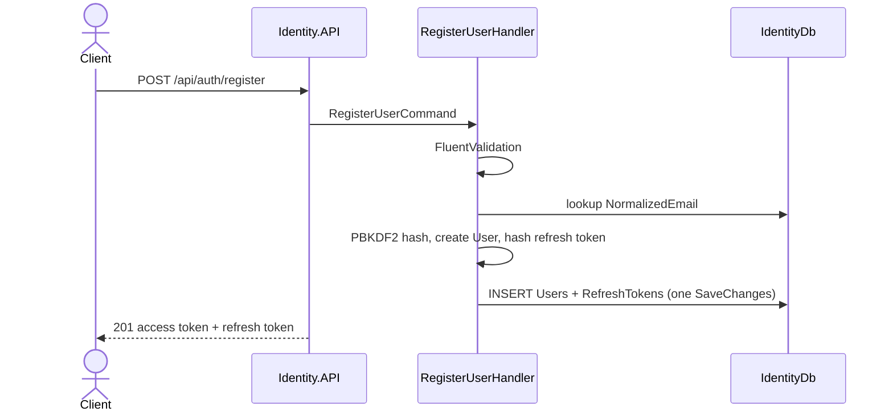
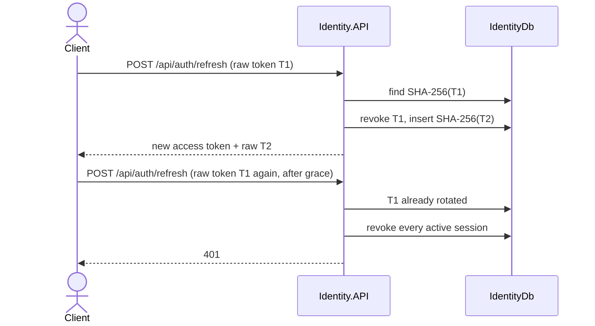

# Identity Service

Identity is the authority for accounts and sessions. It is the first service in the platform, and it is deliberately boring: register, sign in, refresh, revoke, and an admin directory. It does not know about products, carts, or payments.

Other services will trust a signed access token. They will not open `IdentityDb`. That split is the whole point of this phase.

## What this phase teaches

| Idea | Where it shows up |
| :--- | :--- |
| Bounded context | Identity owns users and sessions. It does not own orders. |
| Database per service | `IdentityDb` is private. The migration lives in `Identity.Infrastructure`. |
| Stateless authentication | Access token is a signed JWT. Resource servers validate it locally. |
| Stateful session control | Refresh tokens are rows in `IdentityDb`, stored as hashes, and rotated. |
| Fail closed | The process refuses to start without a connection string and a 32-byte signing key. |
| No secret in git | `appsettings.json` has empty `SigningKey` and connection string. |

## Layout

```
src/Services/Identity/
├── Identity.Domain/            User, RefreshToken, rotation rules
├── Identity.Application/       Handlers, validators, repository port
├── Identity.Infrastructure/    EF Core, SQL Server, PBKDF2, JWT issuer
└── Identity.API/               HTTP, JWT validation, rate limit, ProblemDetails
```

`Identity.Domain` has no NuGet dependencies. Password hashing and SQL stay in Infrastructure. HTTP stays in the API. Handlers depend on ports (`IUserRepository`, `IPasswordHasher`, `IAccessTokenIssuer`), which is what makes the unit tests run without SQL Server.

MediatR is not used. Four handlers do not need a mediator.

## Request flow



Login is the same shape. Refresh loads the user by refresh-token hash, rotates inside the aggregate, and commits. `GET /api/auth/me` does not trust the token's email claim for the profile. It loads the user by `sub` and rejects a deactivated account.

`GET /api/users` and `POST /api/users/{id}/deactivate` require the `AdminOnly` policy. A customer token receives 403. A missing token receives 401.

## Database flow

One SQL Server database: `IdentityDb`.

| Table | Why it exists |
| :--- | :--- |
| `Users` | Account, password hash, role, active flag |
| `RefreshTokens` | Hashed session secrets and rotation chain |

Indexes, and why they exist:

| Index | Query it serves |
| :--- | :--- |
| `IX_Users_NormalizedEmail` unique | Login and registration are point lookups. The stored value is uppercased so uniqueness does not depend on collation. |
| `IX_Users_CreatedAtUtc_Id` | Admin list is `ORDER BY CreatedAtUtc, Id`. The second column keeps a page stable when timestamps tie. |
| `IX_RefreshTokens_TokenHash` unique | Refresh and revoke are point lookups. Uniqueness also rejects a duplicated secret. |
| `IX_RefreshTokens_UserId` | Revoke-all and deactivate load every session for one user. |

`RowVersion` on both tables is SQL Server `rowversion`. Two concurrent refreshes of the same token cannot both commit. The loser becomes `IdentityConcurrencyException` and the client must sign in again. That race is not treated as token theft.

`SaveChanges` is one local transaction. The user row and the new refresh-token row commit together. There is no distributed transaction in this service. If the process dies mid-request, SQL rolls the transaction back. The client retries.

The email unique index is the backstop for two registrations of the same address at the same time. The handler also checks first, which is the common path. The index is the path that is correct under concurrency. SQL errors 2601 and 2627 are mapped to `409 Conflict`. The client never sees a `SqlException`.

Password hashes and refresh-token hashes are columns. Projections for profile and the admin list do not select `PasswordHash`. They use `AsNoTracking` because those reads are never saved.

## Token model



- Access token: 15 minutes, claims `sub`, `email`, `role`, `jti`. Signed, not stored.
- Refresh token: 7 days, returned once, stored only as SHA-256. SHA-256 is enough because the token is 256 bits of `RandomNumberGenerator` output. Passwords are low entropy, so they use slow PBKDF2 instead.
- Reuse inside 30 seconds returns 401 but does not kill the successor session. That covers a double-submitted refresh. It does not give the old token back, because the raw successor was never stored.
- Reuse after 30 seconds revokes every active refresh token for that user. Logs record the user id. The HTTP body stays "Refresh token is invalid." so the endpoint is not an oracle.

`MapInboundClaims` is false. The role claim stays `role`. If inbound mapping is left on, ASP.NET renames it to the long `ClaimTypes.Role` URI and `RequireRole` silently fails.

## Authorization

| Policy | Roles | Used by |
| :--- | :--- | :--- |
| `CustomerAccess` | Customer or Admin | `GET /api/auth/me`, `POST /api/auth/revoke-all` |
| `AdminOnly` | Admin | `GET /api/users`, deactivate |

Registration, login, refresh, and single-token revoke are anonymous. Revoke is anonymous because the refresh token itself is the credential, including after the access token has expired. Unknown refresh tokens still return 204 so callers cannot probe which tokens exist.

There is no global fallback policy yet. Health checks must stay anonymous for probes. When every route exists, the safer default is "deny unless `[AllowAnonymous]`". Public auth routes are already marked anonymous so that switch is mechanical.

Development admin seed runs only when `ASPNETCORE_ENVIRONMENT=Development` and both `Seed__AdminEmail` and `Seed__AdminPassword` are set. Production ignores those settings. A seed password in an app setting would be a standing backdoor.

## Security controls and the threat

| Control | Threat |
| :--- | :--- |
| PBKDF2 password hash | Database backup does not reveal passwords |
| SHA-256 refresh token | Database backup does not grant sessions |
| Generic login error | Email enumeration and password oracles |
| Dummy hash verify when the user is missing | Timing oracle for "account exists" |
| Rate limit on auth routes, keyed by connection address | Password spraying |
| No `X-Forwarded-For` trust yet | Spoofed forwarded headers bypassing the limit |
| `Cache-Control: no-store` on auth responses | Tokens sitting in a shared cache |
| Security headers (`nosniff`, `DENY` framing, CSP `default-src 'none'`) | MIME sniffing and clickjacking of the API host |
| ProblemDetails without exception text | SQL or stack data leaking to clients |
| Startup rejection of a short signing key | Accidental `alg` confusion or empty HMAC key |
| `RequireSignedTokens` and `ValidAlgorithms = HS256` | Unsigned `alg: none` tokens |
| Email unique index | Duplicate accounts under a race |
| Deactivate revokes refresh tokens | A disabled account minting new access tokens |
| Correlation id on the response | Later phases join this request to downstream traces |
| Logs mask email and never log passwords or tokens | PII and secrets in log sinks |

TLS is not redirected inside the process. In Azure, Front Door or Application Gateway terminates TLS. A redirect inside the container breaks HTTP health probes. Turn on HSTS at the edge, not in this Kestrel host, unless this process is the public TLS endpoint.

CORS allows no origins until `Cors:AllowedOrigins` is set. `AllowAnyOrigin` is not used.

## Failure scenarios

| Failure | What the caller sees | What actually happens |
| :--- | :--- | :--- |
| Validation error | 400 ProblemDetails, code `Identity.Validation` | No database write |
| Duplicate email | 409 `Identity.EmailConflict` | Unique index or the pre-check |
| Wrong password or unknown email or inactive user | 401 `Invalid email or password.` | Same body for all three |
| Refresh reuse after the grace window | 401 | All active refresh tokens for that user are revoked |
| Two refreshes commit at once | 401 | `rowversion` rejects the second update |
| SQL exception | 500 generic ProblemDetails | Exception is logged on the server only |
| Signing key missing or short | Process does not start | No weak default key |
| IdentityDb down | `/health/live` is healthy, `/health/ready` is unhealthy | Orchestrator can keep the process but stop sending traffic |
| Access token still valid after deactivate | Other services accept it until it expires | `GET /api/auth/me` already returns 401. This gap is why access tokens are 15 minutes, not hours |
| Refresh response lost | Client retries the old token, then must sign in after the grace window | Successor raw token is not stored |

Azure SQL uses the same `ConnectionStrings:IdentityDb` key and the same migrations. `EnableRetryOnFailure` covers transient failover errors. A retried register cannot create two users because of the unique email index.

Key Vault does not require a code change. Container Apps or App Service reference the secret and inject `Jwt__SigningKey` and `ConnectionStrings__IdentityDb`. Managed identity is the production credential. That wiring is Phase 20. The application already refuses to boot if those values are absent.

## Local development

```powershell
$env:ConnectionStrings__IdentityDb = "Server=localhost,1433;Database=IdentityDb;User Id=sa;Password=<strong-password>;TrustServerCertificate=True"
$env:Jwt__SigningKey = "<random value of at least 32 characters>"
$env:Database__ApplyMigrations = "true"
dotnet run --project src/Services/Identity/Identity.API
```

`Database:ApplyMigrations=true` in Development applies migrations on startup. Leave it false in production and run migrations as a deployment step so several instances do not migrate at the same time.

Useful routes:

| Method | Path | Auth |
| :--- | :--- | :--- |
| POST | `/api/auth/register` | Anonymous |
| POST | `/api/auth/login` | Anonymous |
| POST | `/api/auth/refresh` | Anonymous |
| POST | `/api/auth/revoke` | Anonymous, body holds the refresh token |
| POST | `/api/auth/revoke-all` | Customer or Admin |
| GET | `/api/auth/me` | Customer or Admin |
| GET | `/api/users` | Admin |
| POST | `/api/users/{id}/deactivate` | Admin |
| GET | `/health/live` | Anonymous |
| GET | `/health/ready` | Anonymous |
