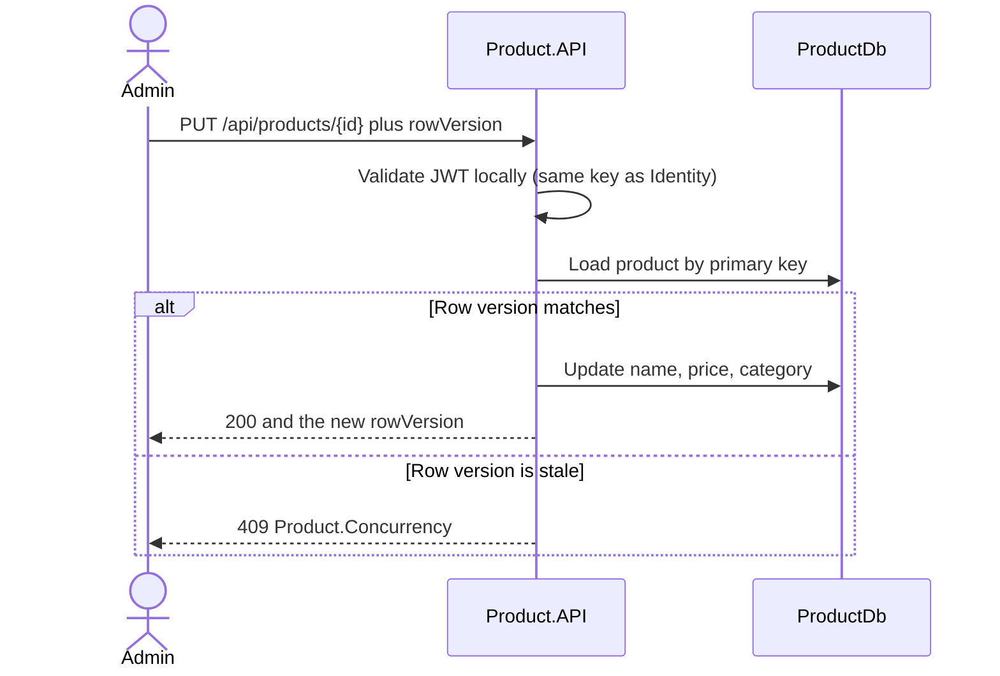

# Product Service

The Product service is the catalog. Customers browse it. Admins edit it. It does not know who is logged in beyond the role claim on the access token, and it does not know how many units are in the warehouse.

That second omission is the lesson. Stock is a different bounded context. It will live in Inventory, with its own database, in a later phase.

## What this phase teaches

| Idea | Where it shows up |
| :--- | :--- |
| Service boundary | Price and name are here. Quantity is not. |
| Database per service | `ProductDb` is a different database from `IdentityDb`. |
| Local token validation | Product checks the JWT signature. It does not call Identity and it does not read `IdentityDb`. |
| Read model versus write model | List and get project the columns the page needs. Updates load one tracked product. |
| Optimistic concurrency | `rowversion` on the product. A stale admin edit returns 409. |
| Query shape | Category pages match a composite index. A search box with `LIKE '%term%'` does not. |

## Layout

```
src/Services/Product/
├── Product.Domain            Category, ProductItem, slug and price rules
├── Product.Application       Handlers and the catalog port
├── Product.Infrastructure    SQL Server, indexes, sample seed
└── Product.API               Anonymous reads, admin writes, JWT validation
```

Role names come from `BuildingBlocks.Contracts` (`Customer`, `Admin`). Identity issues them. Product requires `Admin` for writes. The string is the contract between the two deployables.

## Request flow



Browsing does not send a token.

| Method | Path | Auth |
| :--- | :--- | :--- |
| GET | `/api/products` | Anonymous. `page`, `pageSize` (max 50), `categoryId`, `search`, `sort`, `activeOnly` |
| GET | `/api/products/{id}` | Anonymous. Inactive products look like 404 unless the caller is Admin |
| POST | `/api/products` | Admin |
| PUT | `/api/products/{id}` | Admin. Body includes the `rowVersion` from the last read |
| POST | `/api/products/{id}/deactivate` | Admin, with `rowVersion` |
| POST | `/api/products/{id}/activate` | Admin, with `rowVersion` |
| GET | `/api/categories` | Anonymous |
| POST | `/api/categories` | Admin |
| PUT | `/api/categories/{id}` | Admin. Changes the display name. The slug stays. |
| POST | `/api/categories/{id}/deactivate` | Admin. Blocks new products. Does not unpublish existing ones |

Sort values: `name` (default), `priceAsc`, `priceDesc`, `newest`.

There is no synchronous call from Product to any other service. The browser, or later the gateway, is the only caller.

## Database flow

`ProductDb` only.

| Table | Owns |
| :--- | :--- |
| `Categories` | Name, stable slug, active flag |
| `Products` | SKU, name, description, price, currency, category, active flag, rowversion |

`FK_Products_Categories_CategoryId` is `ON DELETE NO ACTION` (restrict). A category that still has products cannot be deleted. The API does not offer a hard delete.

Indexes:

| Index | Query |
| :--- | :--- |
| Unique `IX_Categories_Slug` | Create-category and any future slug URL |
| `IX_Categories_IsActive_Name` | Public category menu, ordered by name |
| Unique `IX_Products_Sku` | Admin create, and the future lookup Inventory will do by SKU through the API |
| `IX_Products_CategoryId_IsActive_Name` | Category page: filter by category and active, order by name |
| `IX_Products_IsActive_Name_Id` | Catalog home: active products ordered by name. `Id` makes the page stable |

`CK_Products_Price_NonNegative` rejects a negative price even if a future code path skips the domain check. Price is `decimal(18,2)`. Currency is `nchar(3)` and the domain allows only USD, EUR, and GBP.

The list query is one SQL statement: filter, order, offset/fetch, join to `Categories` for the category name. It does not load product entities and then query categories per row. That would be an N+1. `AsNoTracking` is used because the list is never saved.

`COUNT(*)` is a second round trip. That is acceptable at this page size. A large `page` number still makes SQL Server read and discard the skipped rows. Keyset pagination is the later fix, not OFFSET.

Search uses `Contains`, which SQL Server turns into `LIKE '%term%'`. The name index does not serve that predicate because of the leading wildcard. A catalog of this size can live with it. A large catalog wants full-text search, not another B-tree.

Two admins editing the same product:

1. Both GET the product and receive the same `rowVersion`.
2. The first PUT matches the version, updates the row, and SQL Server changes `rowversion`.
3. The second PUT either sees the new version on read and returns 409, or loses the race inside `SaveChanges` and the concurrency token throws. Both paths are `409 Product.Concurrency`. The second price is not written.

A duplicate SKU from two creates at once hits unique index `IX_Products_Sku` (SQL 2601/2627) and becomes `409 Product.SkuConflict`. The client never sees a `SqlException`.

## Security

| Control | Threat |
| :--- | :--- |
| Anonymous catalog reads | Shoppers are not forced through Identity for a product page |
| Admin policy on every write | A customer token cannot change a price |
| Same issuer, audience, HMAC key, and `role` claim as Identity | A token minted for another application is rejected |
| `MapInboundClaims = false` | Role checks fail closed if the claim is renamed by the JWT handler |
| Inactive products hidden from anonymous GET | Unreleased SKUs are not enumerable as 200 responses |
| Non-admins cannot pass `activeOnly=false` | The query string cannot bypass that hide |
| Page size capped at 50 | A single request cannot pull the whole table |
| Search length capped at 100 | A giant `LIKE` pattern cannot be submitted |
| Rate limit, 120 requests per minute per connection address | Catalog scraping from one address |
| ProblemDetails without SQL text | Schema and constraint names stay on the server |
| No cache headers yet | A shared cache would keep a stale price after an admin edit |

Product does not issue tokens and does not store users. If Identity is down, existing access tokens still authorize admin edits until they expire. Browsing does not need Identity at all.

## Failure scenarios

| Failure | Caller sees |
| :--- | :--- |
| Invalid sort, page, or price | 400 `Product.Validation` |
| Unknown product, or inactive product as a shopper | 404 |
| Duplicate SKU or slug | 409 |
| New product assigned to an inactive category | 409 `Product.CategoryUnavailable` |
| Stale `rowVersion` | 409 `Product.Concurrency`. The stored price is unchanged |
| Customer token on POST | 403 |
| Missing token on POST | 401 |
| Short signing key | Process refuses to start |
| `ProductDb` down | `/health/live` stays healthy. `/health/ready` fails |
| Inventory is down | Catalog reads still succeed. Stock is not on this service |

## Local development and Azure

```powershell
$env:ConnectionStrings__ProductDb = "Server=localhost,1433;Database=ProductDb;User Id=sa;Password=<strong-password>;TrustServerCertificate=True"
$env:Jwt__SigningKey = "<the same key Identity uses>"
$env:Database__ApplyMigrations = "true"
$env:Database__SeedSampleCatalog = "true"
dotnet run --project src/Services/Product/Product.API
```

Swagger: `http://localhost:5102/swagger`

Development seed inserts Books, Electronics, and two sample products. It runs only when the environment is Development and the seed flag is true. It is idempotent on slug and SKU.

On Azure this process becomes its own Container App or App Service, with its own Azure SQL database. The signing key and the connection string come from Key Vault through the same environment variable names. Product does not get a firewall rule to `IdentityDb`.
