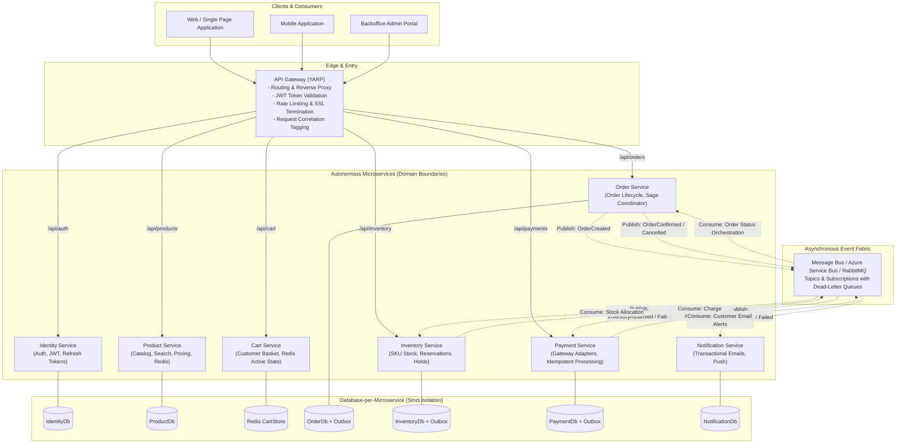
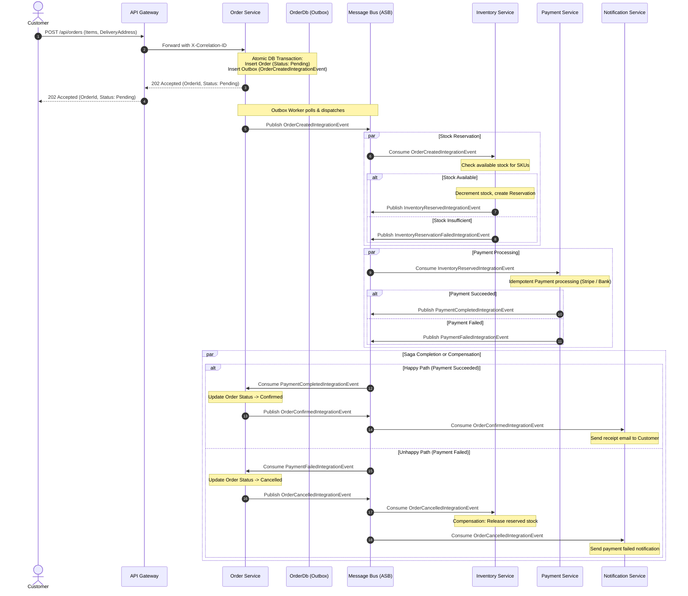
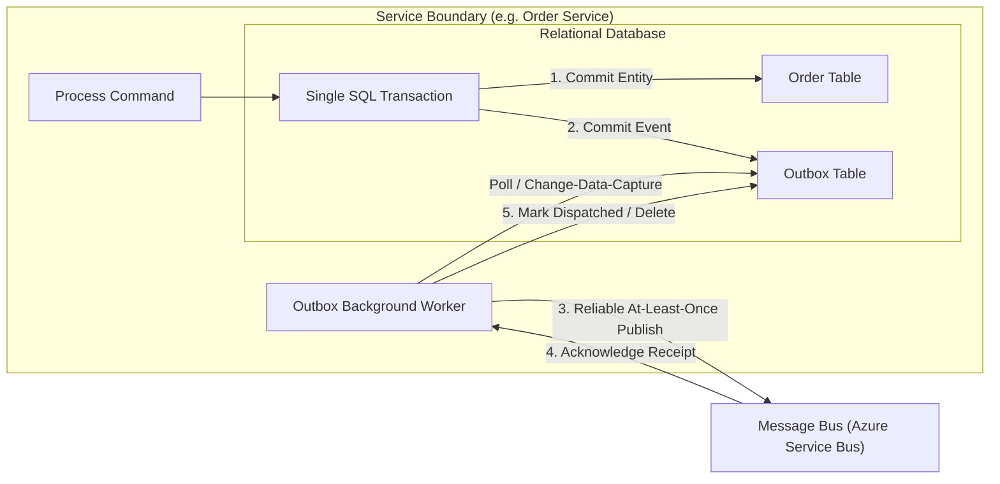
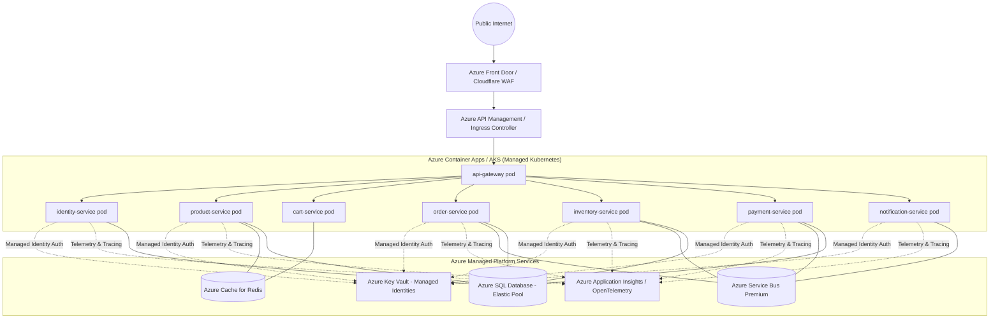

# Overall System Architecture

This document outlines the architectural blueprint for the **E-Commerce Order Management Platform**, designed from the ground up for high reliability, autonomous scalability, clean boundaries, and zero-downtime evolution.

---

## 1. High-Level Topology

---

## 2. Order Fulfillment Flow (Choreographed Saga & Compensation)

---

## 3. Transactional Outbox Pattern

---

## 4. Azure Production Deployment Blueprint

